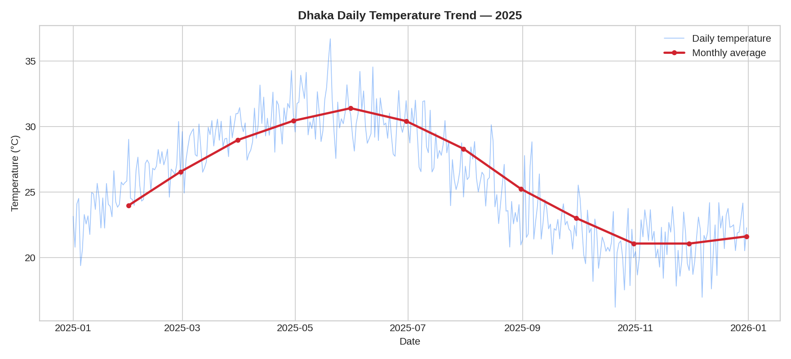
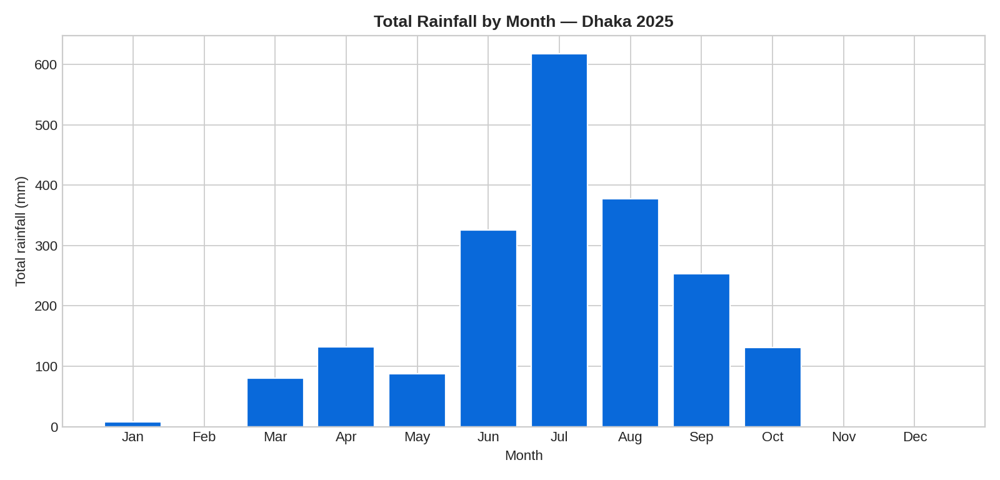
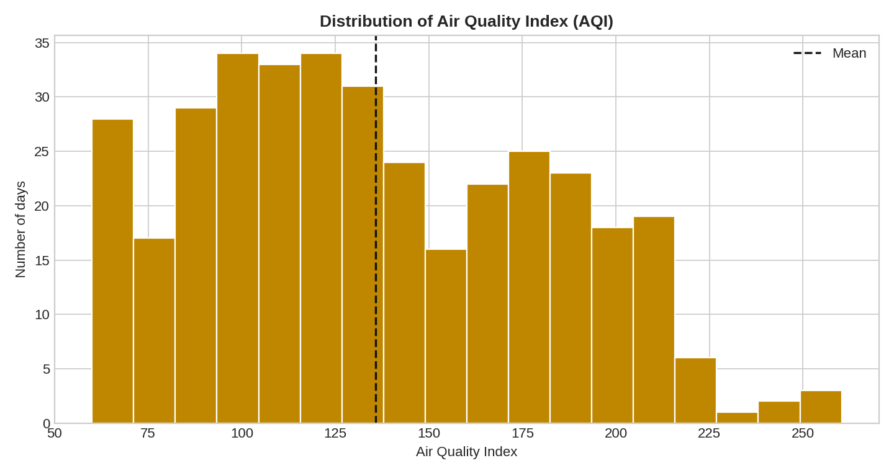

# Dhaka Weather Data Analysis

A complete beginner-friendly **Data Science project** built with **Pandas, NumPy and Matplotlib**. It analyses a full year of daily weather for Dhaka — temperature, humidity, rainfall, wind and air quality — month by month and season by season.

📖 **New here?** Read the full step-by-step explanation of everything in this project: [PROJECT_GUIDE.md](PROJECT_GUIDE.md)

> The dataset in this project is synthetic practice data generated with NumPy, modelled on Dhaka's real seasonal patterns: a cool dry winter, a hot summer, heavy monsoon rain and poorer winter air quality. It is made for learning the full workflow: data generation → cleaning → analysis → visualization → insights.

## Project Highlights

- Generate 365 days of realistic weather data with **NumPy**
- Clean and explore time-series data with **Pandas**
- Create monthly and seasonal summary tables with `groupby` and aggregation
- Build clear visualizations with **Matplotlib**
- Save charts, tables and written insights automatically

## Questions This Project Answers

1. Which month is the hottest, and which is the coolest?
2. How much rain falls in the monsoon compared with winter?
3. Which season has the worst air quality?
4. Are humidity and temperature related?
5. How many rainy days are there in a year, and which day was the rainiest?

## Dataset Columns

| Column | Meaning |
|---|---|
| `date` | Day of the record, 2025-01-01 to 2025-12-31 |
| `month` | Month number, 1–12 |
| `season` | Winter (Nov–Feb), Summer (Mar–May) or Monsoon (Jun–Oct) |
| `temperature_c` | Daily temperature in °C |
| `feels_like_c` | Feels-like temperature in °C (higher with humidity) |
| `humidity_percentage` | Relative humidity in % |
| `rainfall_mm` | Rainfall in millimetres (0 on dry days) |
| `wind_speed_kmh` | Wind speed in km/h |
| `air_quality_index` | Air Quality Index (higher = worse air) |

## Project Structure

```text
dhaka-weather-data-analysis/
├── README.md
├── requirements.txt
├── data/
│   └── dhaka_weather_2025.csv
├── src/
│   ├── generate_dataset.py
│   └── analysis.py
├── notebooks/
│   └── dhaka_weather_analysis.ipynb
└── outputs/
    ├── insights.md
    ├── tables/
    │   ├── summary_statistics.csv
    │   ├── monthly_weather_summary.csv
    │   ├── season_summary.csv
    │   └── correlation_matrix.csv
    └── charts/
        ├── daily_temperature_trend.png
        ├── monthly_rainfall.png
        ├── humidity_vs_temperature.png
        └── air_quality_distribution.png
```

## Quick Start

```bash
git clone <your-repository-url>
cd dhaka-weather-data-analysis
pip install -r requirements.txt
python src/generate_dataset.py
python src/analysis.py
```

After running the analysis, open:

- `outputs/insights.md` for the key findings
- `outputs/charts/` for all visualizations
- `outputs/tables/` for the summary CSV files

## Sample Visualizations







## Tools Used

- **Python**
- **Pandas** — data cleaning, grouping and analysis
- **NumPy** — synthetic data generation, trend line and numerical work
- **Matplotlib** — line, bar, scatter and histogram charts

## Future Improvements

- Replace the synthetic dataset with real observed weather data
- Add a Jupyter notebook walkthrough for presentation
- Compare two years side by side
- Build an interactive dashboard with Streamlit

## Note

This project is for Data Science practice. The data is synthetic and modelled on Dhaka's seasonal patterns — it is not a real weather record.
